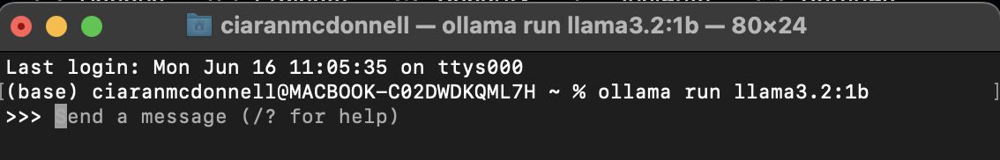
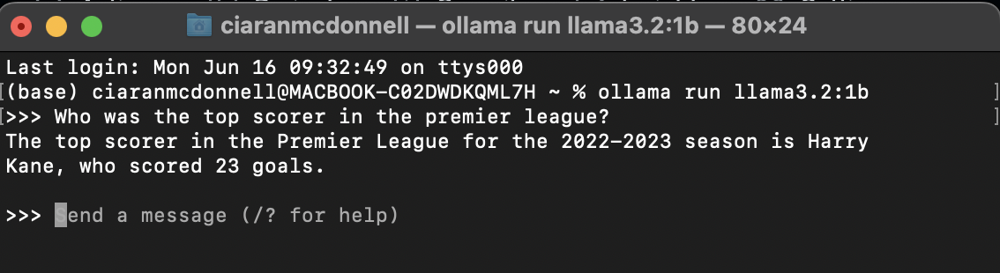
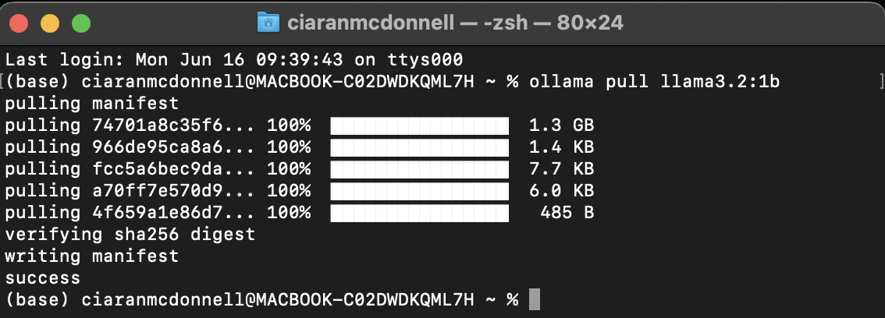

# CV Assistant

This CV Assistant uses Retrieval-Augmented Generation (RAG) to play the role of a chatbot assistant for recruiters (or anyone interested) asking questions about a candidate's details, experience and anything else one might expect to find on a CV. 
### Built using `ollama`
 - Simple install via PyPI `pip install ollama`
 - Download and host LLMs locally, prompting them from your terminal



 - Of course be aware that these will be static, pre-trained models tha might have been trained on data from a few years ago


 - Download or update model without starting session with `ollama pull modelNameVersion:size`


## Project Installation

Not yet installable. Clone repo if interested.

## Usage
### Loading documents for RAG 
- NOTE: only using one document for now 
```python
documents = []
with open("path/to/document.txt", encoding="utf-8") as cv:
    context = cv.readlines()

documents.append(" ".join(context).replace("\n", " "))
``` 

### Choosing model and generating response
```python
cv_assist = CVAssistant(model="model", documents=documents)

cv_assist.print_response(question="My question about the candidate")
```
see [ollama repo](https://github.com/ollama/ollama) for available models.

## Example outputs
### Big Data Role
 - Prompt:
```python
cv_assist = CVAssistant(model="llama3.2:1b", documents=documents)

cv_assist.print_response(question="Summarise the candidate's experience in big data")
```
 - Response (with company names etc. removed):
```python
 """Based on the candidate's CV, here is a summary of their experience in big data:

* Lead Data Analyst at ****** Ltd. (June 2022 - December 2022): Built automated, scalable ETL pipelines to extract, transform, and load data from multiple sources through SQL databases.
* Ph.D. Researcher (October 2018 - May 2023) at ******: Simulated, analyzed, and visualized large complex data sets using proficient skills in Matlab, Python, and Excel.
* Coursework and Computational Lab Demonstrator (September 2013 - May 2018): Assessed weekly coursework in various areas of physics, including computational programming for mathematical and physical sciences.
* Tutor (Self-Employed, ******) from September 2017 to June 2018: Set up a tutoring business, teaching Mathematics and Physics to university and secondary-level students.

The candidate has extensive experience with data analysis, visualization, and big data concepts such as:

* ETL pipelines
* SQL databases
* Data mining (Python)
* Machine learning (Scikit-learn, TensorFlow, Keras)
* Data visualization (Matplotlib, Seaborn, Cufflinks)
* Statistical modeling (regression, probability distributions, p-value and hypothesis testing)

Additionally, the candidate has experience with:

* Handling large complex data sets
* Using computational programming languages for mathematical and physical sciences
* Presenting research findings to colleagues and peers

Overall, the candidate has a strong background in big data analysis, with experience in building scalable solutions, analyzing complex data sets, and visualizing results. """
```

### Finance Role
 - Prompt:
```python
cv_assist = CVAssistant(model="llama3.2:1b", documents=documents)

cv_assist.print_response(question="Does the candidate have any experience in finance?")
```

```python
Based on the provided CV, it appears that the candidate does not have direct experience in finance. However, there are a few instances where their skills and expertise could be applied to a financial role:

1. **Data Analysis**: The candidate has extensive experience in data mining, statistical modeling, and machine learning, which can be useful in analyzing financial data.
2. **Financial Modelling**: They have built automated ETL pipelines for extracting, transforming, and loading data from multiple sources, which could be applied to financial modeling.
3. **Data Visualization**: The candidate is proficient in creating visualizations using tools like Matplotlib and Seaborn, which can be used to present financial data.

Although the candidate does not have direct experience in finance, they seem to possess a strong foundation in quantitative analysis and problem-solving, skills that are highly transferable to a financial role. To bridge this gap, they could potentially focus on learning more about finance-specific concepts, such as financial modeling, risk management, or portfolio optimization.

In the job description, it's essential to highlight the candidate's ability to learn and adapt quickly, which is evident in their experience with complex problem-solving and data-driven decision making. The recruiter should also emphasize the candidate's passion for finance and willingness to learn, as these traits are highly valuable in a financial role.
```

## Contributing

Pull requests are welcome. For major changes, please open an issue first
to discuss what you would like to change.

Please make sure to update tests as appropriate.

<!-- ## License

[MIT](https://choosealicense.com/licenses/mit/) -->
